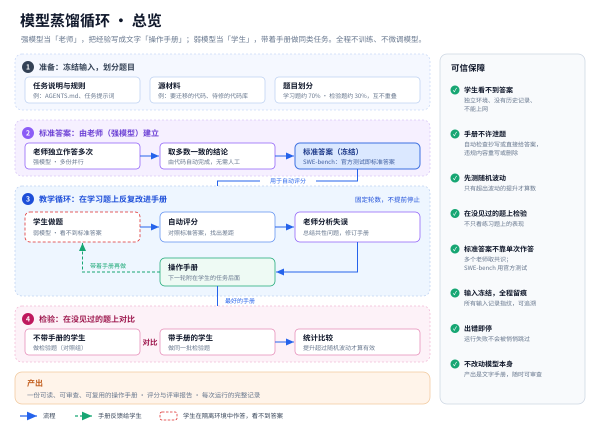

# 模型蒸馏循环：管理层简介

> **一句话：** 让强模型当"老师"，把做事的经验写成一份文字版"操作手册"（playbook）；弱模型当"学生"，带着手册做同类任务，效果向强模型靠拢。整个过程**不训练、不微调任何模型**，最终产出是一份可阅读、可审查、可复用的文档。

---

## 为什么要做

- **强模型**效果好，但成本高、速度慢，通常只能通过云端调用。
- **弱模型**便宜、快，可以部署在本地或内网。
- **目标：** 用一份手册缩小两者的差距，让弱模型承担更多日常工作。

## 四个角色

| 角色 | 由谁担任 | 职责 |
|---|---|---|
| 老师（oracle） | 强模型 | 做出参考答案，或示范怎么做 |
| 学生（student） | 弱模型 | 独立完成任务，全程看不到答案 |
| 评分 | 代码 + 评审模型，或官方测试 | 自动给学生打分，指出差距在哪里 |
| 手册作者（synthesizer） | 强模型 | 分析学生的失误，写出或修订手册 |

---

## 工作流程

整个流程分四步：

1. **准备：** 任务说明、规则和源材料在开工前冻结，所有角色看到的内容完全相同；题目按约 70% / 30% 分成学习题和检验题，两组互不重叠。
2. **建立标准答案：** 多个老师（强模型）各自独立作答，由代码取多数一致的结论作为标准答案，并自动冻结，不需要人工审核。SWE-bench 场景则直接使用官方测试作为标准答案。
3. **教学循环：** 学生（弱模型）做学习题 → 自动评分 → 老师分析失误、修订手册 → 下一轮学生带着新手册再做。开始前先测出学生不带手册的水平和分数的随机波动；轮数事先固定，不会因为某次分数好就提前停止。
4. **检验：** 拿出最好的手册，在学生从未见过的检验题上，对比带手册与不带手册的表现，只有超过随机波动的提升才算有效。

技术细节（隔离运行、评分方式、泄题检查等）见英文版详细架构图 [architecture.svg](architecture.svg)。

---

## 同一套方法，两个应用场景

| | 迁移规划（OpenSpec） | 修复真实 Bug（SWE-bench） |
|---|---|---|
| 任务 | 为 HMOS 通话模块迁移到 liteOS 编写规划文档 | 修复开源项目 Django 的真实 GitHub 问题 |
| "标准答案" | 多个老师结论的多数共识 | 官方隐藏测试：测试通过即视为修好 |
| 评分方式 | 代码比对关键决策和覆盖范围，评审模型给出质量分 | 官方评测工具运行测试 |
| 老师 / 学生 | GLM 5.3 Max / GLM 5.3 High | Qwen3-32B / Qwen3-8B（本地部署） |
| 学习与检验 | 同一个任务，多次独立作答 | SWE-bench Lite 中的 114 道 Django 题按 70% / 30% 划分：约 80 道用来学习，约 34 道用来检验（两组不重叠） |

SWE-bench 场景的关键在于：手册是在一批题上学出来的，却要在学生**从未见过的题**上检验，因此能回答"手册是否真的学到了可迁移的经验"。

---

## 与研究方向 5 的对应关系

> 方向 5：面向资源不对称环境的老师–学生 Agent 行为蒸馏与输出件迁移技术

本系统是方向 5 核心路线的一个可运行原型。老师 Agent（最优资源配置）观察学生 Agent（受限环境的镜像配置）的完整行为，定位偏差，再把修正经验沉淀为一份标准化输出件，也就是本文中的"操作手册"。学生加载这份输出件后再做同类任务，既不需要访问老师，也不改动模型本身。

### 术语对照

| 方向 5 中的说法 | 本系统中的对应 |
|---|---|
| 老师 Agent（最优模型 / Agent / 上下文） | 老师（oracle）与手册作者（synthesizer），使用强模型 |
| 学生 Agent（受限环境镜像配置） | 学生（student），使用弱模型或低开销配置 |
| 输出件 | 操作手册 `playbook.md`，附修订记录 `changelog.md` |
| 定向学习 | 一次运行：一个代码仓、一类任务、产出一份手册 |
| 迁移门禁 | 泄题检查，加上在没见过的题上的统计检验 |

### 两种蒸馏形态

| 形态 | 方向 5 中的例子 | 本系统现状 |
|---|---|---|
| 同一模型、不同配置 | fp16 + 1M 上下文 → fp4 + 200k 上下文 | SWE-bench 场景（自部署模型服务）支持：老师和学生各自的量化方式、上下文长度在启动时配置，并被记录和锁定。迁移规划场景的老师与学生是同一模型族的不同档位（GLM 5.3 Max / High） |
| 同一系列、跨模型 | Qwen 3.8 → Qwen 3.8 Flash | SWE-bench 试点即属此类：Qwen3-32B → Qwen3-8B |

### 各项研究内容的现状

| 研究内容 | 已具备 | 有待研究 |
|---|---|---|
| **5.1 输出件体系设计** | 输出件是纯文本手册，附加到任务提示中即为加载，去掉即为卸载；每一轮的手册单独保存，记录版本以及基于哪一版修订；有长度上限和编写规则：可以写工作流程、工具用法、常见错误的规避方法和通用领域知识，不可以写具体题目的答案 | 把手册拆分为固定的结构化分区（上下文组织、提示与工作流模板、工具规范、领域知识、失败模式规则）；多份手册的组合加载 |
| **5.2 行为蒸馏学习机制** | 老师读取学生每次作答的完整过程记录（每一步工具调用）、评分指出的差距，以及更强模型的成功做法，找出反复出现的偏差并写入下一版手册；按代码仓和任务类型定向学习，轮数固定。迁移规划场景中，若新版手册效果明显变差，会自动改为基于上一版重新修订 | 作答过程中的实时修正：目前的修正发生在两次作答之间，而不是作答过程中 |
| **5.3 质量验证与迁移门禁** | 泄题检查（违规内容重写或删除）；先测随机波动；在没见过的题上做带手册与不带手册的对比和统计检验；任何一次运行失败都会让流程停下，不会带病通过 | 通用 Coding 能力不劣化的冒烟测试，例如用其他代码仓的题目做回归；多份手册之间的冲突检测与组合验证 |
| **5.4 迁移与生效机制** | 手册是纯文本，不依赖特定模型或工具；学生在独立环境中按受限环境的配置运行；SWE-bench 场景全部使用开源模型和开源 Agent（opencode），接近受限环境；手册只增加提示长度，不增加推理次数 | 测量镜像环境与真实受限环境（自研 Agent、真实模型版本和上下文窗口）之间的迁移损耗；建立生效效果的回传观测通道；"达到老师效果的 xx%"指标可用"学生带手册的解题率 ÷ 老师的解题率"衡量，还需补测老师在检验题上的解题率作为分母 |
| **5.5 任务级效率与标准流程** | 全流程自动化（准备 → 标准答案 → 教学循环 → 检验），不需要人工审核，中断后可以接着跑；一次运行对应一个代码仓、一类任务、一份手册；手册有长度上限，每轮整体修订而不是不断追加，避免膨胀；按任务加载，用后可以丢弃 | 把单个模块的学习周期压缩到小时级：迁移规划场景目前每轮约 1–2 小时，SWE-bench 场景取决于服务器算力，将在试点中测量；沉淀为公司的标准开发流程 |

---

## 如何保证结果可信

- **学生看不到答案：** 运行在独立环境中，没有历史记录，不能上网（SWE-bench 场景只能访问模型服务）。
- **手册不能泄题：** 自动检查手册是否抄写答案或直接给出结论；违规内容会被要求重写，仍不合格的会被删除。
- **先测波动，再看提升：** 只有超过随机波动的提升才算数。
- **用新样本做最终验证：** 避免"挑分数最高的那一次"造成的虚高。
- **全程留痕：** 所有输入在开工时冻结并记录指纹。任何一次运行出错都不会被悄悄跳过，而是让流程停下，处理后再继续。

## 局限

- **检验题数量有限：** 约 34 道检验题能看出明显的效果，但较小的提升可能在统计上难以确认。
- **手册针对一类任务：** 换到其他领域，需要重新蒸馏一份手册。
- **自动评分有噪声：** 已通过多次独立评审、多次抽取和统计检验加以控制。

## 下一步：在 SWE-bench 上测试

1. **环境就绪：** 在服务器上部署老师与学生模型，完成环境自检（模型服务、隔离容器、网络限制、官方评测工具）。
2. **划分题目：** 把 SWE-bench Lite 中的 114 道 Django 题按 70% / 30% 随机分为学习组（约 80 道）和检验组（约 34 道）。
3. **学习：** 在学习组上先测学生不带手册的水平和随机波动，再进行两轮手册修订。
4. **检验：** 在检验组（学生从未见过）上，对比学生带手册与不带手册的解题率。
5. **决定是否推广：** 如果结果积极，再推广到其他代码库和任务类型。

## 后续研究（对应方向 5 的待补充项）

1. **通用能力回归（5.3）：** 用 Django 以外代码仓的题目，检验带手册的学生在通用 Coding 能力上不劣化。
2. **配置级蒸馏（5.1 / 5.4）：** 同一模型以 fp16、长上下文的配置当老师，以 fp4、短上下文的配置当学生，验证"同模型、不同配置"的形态。
3. **真实环境迁移（5.4）：** 把手册放到自研 Agent 和真实受限配置中运行，测量迁移损耗，并建立效果回传。
4. **输出件结构化与组合（5.1 / 5.3）：** 统一手册的分区结构，研究多份手册的组合加载与冲突检测。
5. **学习周期压缩（5.5）：** 缩短单模块定向学习的周期，并把整套流程沉淀为标准开发流程。
