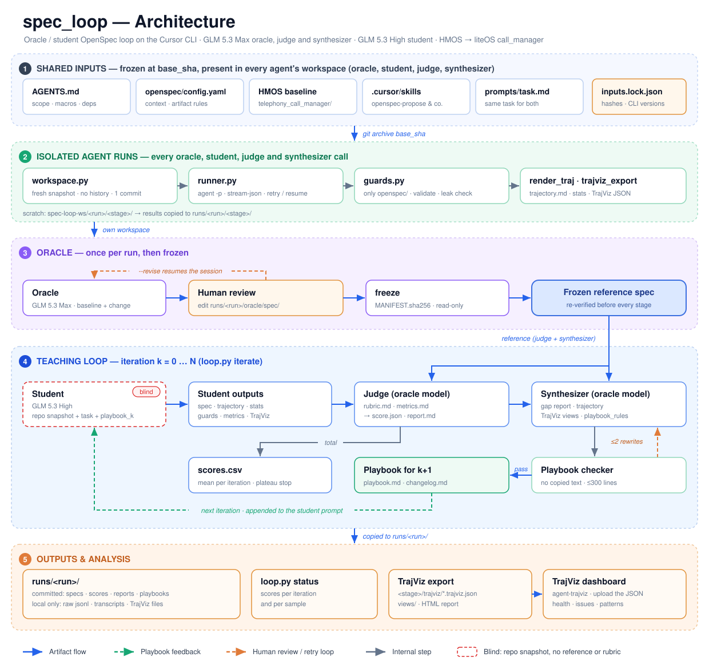

# spec_loop

[English](README.md) | 简体中文

**教一个较弱的模型写 OpenSpec。** 由强模型 oracle 写出参考 OpenSpec，经人工审阅后冻结。较弱的 student 模型针对同一任务写出自己的 spec，全程看不到参考答案。随后 oracle 对两者的差距打分，并写出一份 playbook（执行手册），student 在下一次尝试时会拿到这份手册。循环运行固定轮数，分数变化对照实测的噪声阈值判断，最后用新样本做消融实验，检验最好的 playbook 是否真的有用。

任务内容：把 HMOS 的 `telephony_call_manager` 模块（OpenHarmony v6.0）移植到 liteOS 手表平台，约束见 `communication_mcu/AGENTS.md`。本阶段只产出规划文档：HMOS 模块的 baseline 能力规格，以及一个迁移 change `migrate-call-manager-to-liteos`，不写任何产品代码。

所有 agent 都通过 Cursor CLI（`agent -p`）无界面运行，每个 agent 使用一份独立的、用完即弃的仓库快照。工具本身只依赖 Python 标准库。

---

## 架构



1. **共享输入。** `AGENTS.md`、`openspec/config.yaml`、HMOS 模块、OpenSpec skills 和 `prompts/task.md` 固定在 `base_sha`，对每个 agent 完全相同。`inputs.lock.json` 记录它们的哈希和 CLI 版本。
2. **隔离的 agent 运行。** 每一次 oracle、student、extractor（决策抽取）、judge（评审）和 synthesizer（手册生成）调用都使用一份没有 git 历史的新快照，经 `runner.py` 运行，再由 `guards.py` 检查。其执行轨迹会被渲染成便于阅读的文本，并导出给 TrajViz。
3. **Oracle。** oracle 只写一次参考 spec，extractor 提出它的决策表。你审阅两者，可以直接编辑，也可以让 oracle 修改，然后冻结。之后的运行用 `prepare --reference-from` 复用冻结的参考答案。
4. **基线与噪声。** 第 0 轮运行多个不带 playbook 的 student，每个都与冻结的参考答案对比，由两次独立评审打分。第一份 playbook 依据全部样本的差距（反复出现的优先）以及中位数样本的完整报告和执行轨迹写成。样本间、评审间与两次提取之间的离散度给出噪声估计，代码从第 1 轮起使用它：判断分数变化是噪声内还是显著，以及决定 synthesizer 何时撤回一次 playbook 修订。
5. **教学循环。** 第 1 到 N 轮。student 在看不到参考答案的情况下写 spec。评分先在代码中把它的决策表与参考比对，再由 judge 裁定不一致项并给四个质量分项打分，总分由代码计算。synthesizer 根据差距和 student 的执行轨迹写出下一版 playbook，脚本检查其中是否抄了原文或泄漏答案；循环运行固定轮数。
6. **验证。** 循环结束后，用新的 student 重测最高分的 playbook，并与第 0 轮不带 playbook 的基线 student 对照。
7. **产出与分析。** spec、分数、评审报告和 playbook 都存放在 `runs/<run>/`；执行轨迹可以在 TrajViz 中打开。

---

## 环境要求

- Linux 或 WSL，Python 3.10+（无需第三方包）
- Cursor CLI `agent`，且已登录（`agent status`）
- OpenSpec CLI 1.13+（`openspec`）
- `git` 和 `tar`
- 目标仓库（`config.json` 中的 `repo`）包含提交 `base_sha`，且 OpenSpec skills 位于 `<cursor_dir>/skills/openspec-*`
- 可选：带虚拟环境的 TrajViz 检出目录（`trajviz.bin`），用于生成分析视图和 HTML 报告

---

## 快速上手：冒烟测试

冒烟测试用一个极小的任务（只写一个能力）在约 10 分钟内跑通整条流水线，所有角色都使用 student 模型：

```bash
cd spec_loop
python3 loop.py smoke --run smoke1
```

它依次运行 oracle、冻结、student、judge 和 synthesizer，最后打印 PASS/FAIL 检查清单，内容包括：每次运行实际报告的模型、对话记录是否已复制、各项检查、冻结清单、合法的分数、被接受的 playbook，以及 playbook 是否已插入下一轮 student 的提示词。

---

## 运行循环

```bash
cd spec_loop
python3 loop.py prepare --run r1             # 锁定输入，解出 base 快照
python3 loop.py oracle  --run r1             # oracle 写参考 spec
python3 loop.py student --run r1 --iter 0    # 可选：并行启动基线 student
```

审阅 `runs/r1/oracle/spec/openspec/`。可以直接编辑文件，也可以让 oracle 修改，或两者结合。修改会恢复 oracle 原来的会话，并先把你的直接编辑同步进它的工作区：

```bash
python3 loop.py oracle --run r1 --revise "在 design.md 中说明 VoIP 决策并引用 AGENTS.md"
python3 loop.py oracle --run r1 --revise-file review-notes.md
```

满意后抽取参考 spec 的决策表，人工核对，再一起冻结。冻结后两者都不再改变，之后每个阶段都会校验其哈希：

```bash
python3 loop.py extract --run r1 --target oracle   # 两次抽取；写出 oracle/decisions.review.md
# 阅读 oracle/decisions.review.md；需要更正时直接改 oracle/decisions.proposed.json 中的值
python3 loop.py freeze  --run r1
```

之后的运行可以复用已冻结的参考答案，不必再跑 oracle。先测一次噪声，再迭代，最后检验最好的 playbook：

```bash
python3 loop.py prepare --run r2 --reference-from r1          # 复制冻结的 spec、清单和决策表
python3 loop.py student --run r2 --iter 0 --samples 3         # 三个不带 playbook 的 student
python3 loop.py compare --run r2 --iter 0 --judges 2          # 每个 student 两次独立评审
python3 loop.py noise   --run r2                              # 离散度、提取器噪声与阈值
python3 loop.py iterate --run r2 --start 0 --iters 4          # 第 0-2 轮写 playbook，第 1-3 轮打分
python3 loop.py ablate  --run r2 --playbook top --samples 3   # 带最高分 playbook 的新 student 对比基线
python3 loop.py status  --run r2
```

`iterate` 运行固定轮数，不会提前停止：每轮只有一个样本时，大多数分数变化都在噪声范围内，提前停止只会在噪声上停下。它会跳过已完成的阶段，因此中断后重新运行是安全的；最后一轮不写 playbook。已完成的阶段只有记录对得上才算数：用别的提示词跑出的 student 会让循环停下（请 reset 该轮），由别的 student spec 得出的分数会重新打分。使用 `--samples M` 时，每一轮并行运行 M 个 student：该轮分数取其中有效样本的平均值，synthesizer 从中位数那个样本中学习。使用 `--judges N`（默认取 config.json 的 `judges`）时，每个样本由 N 次独立评审打分，样本分为它们的平均值。

各阶段耗时较长：oracle 约 45 分钟，student 30 到 70 分钟，两次评审的 compare 约 25 分钟，synthesize 连同泄漏检查 15 到 35 分钟。建议后台运行：

```bash
nohup python3 -u loop.py iterate --run r2 --start 0 --iters 4 > runs/r2-iterate.log 2>&1 &
```

### 如何读噪声与消融结果

- **噪声**（`noise.md`、`noise.json`，以及 `state.json` 中的 `noise`）。用第 0 轮的有效样本计算，它们必须用同样的评审次数 J 打分：σ_judge = sqrt(样本内各评审总分方差的均值)；σ²_student = var(样本均值)。后者不减去 σ²_judge / J：样本只有几个时，减完常被截成 0，阈值里就只剩评审噪声；不减则估计偏保守。一轮分数是 n 个有效样本、每个 J 次评审的均值，方差为 σ²_student / n + σ²_judge / (n J)。两轮分数之差超过 2 × sqrt(方差_a + 方差_b) 才算显著；两轮都只有 1 个样本时即 2 × √2 × σ，也就是 `status` 显示的 `threshold`。在 σ²_student 改为这种定义之前测得的基线不再用于标记，需重新运行 `noise`（`--extract-passes 1` 不运行任何 agent）。`noise` 默认还会对每个样本再提取一次决策表（`--extract-passes 1` 可跳过）：每个样本只提取一次、所有评审共用，所以提取器的噪声算在 σ_student 里。`noise.md` 按样本列出两次提取读法不同的决策和它们最多能影响多少分（上界，`σ_extract ≤`），并列出在样本之间、评审之间结果翻转的决策项，其中提取器自己造成的单独标出。每个运行只测一次：改了评分标准、评审提示词、评审模型或评分代码后，只需对已有 spec 重新评审；改了 student 模型、任务或参考答案，应新建运行。
- **轮次标记。** `status`、`scores.csv`（`vs_best` 列）和 iterate 日志把每轮分数与之前最好的一轮比较，按这两轮的阈值标为 "within noise" 或 "significant"。`gaps_closed` 和 `gaps_reopened` 统计由代码给出的差距 id（决策、覆盖、规则）中，相比上一轮消失的个数，以及曾被关闭后又重新出现的个数。
- **回退。** synthesizer 默认修改最新的 playbook；如果最新一轮明显低于它的父轮次（使用"最新 playbook 所修订的那一份"的那一轮；从头写的 playbook 的父轮次是第 0 轮），就改为修改父 playbook，并把较差那一份作为证据提供。与父轮次比，而不是与之前最好的一轮比，是因为几个有噪声分数中的最大值偏高，轮次一多就会更频繁地误触发回退。`state.json` 为每份 playbook 记录 `based_on`（以及 `reverted_from`）。没有噪声基线时既不标记也不回退，`iterate` 和 `synthesize` 会给出警告。
- **消融**（`ablation/report.md`、`ablation/ablation.json`）。"最高分的 playbook" 指原始轮分数最高的那一份；它是从有噪声的分数中挑出来的，因此分数偏高，用新样本可以纠正。默认两组用同样方式评审：无，即第 0 轮的有效基线 student（不新跑）；完整，即至少三个带着通过泄漏检查的 playbook 的新 student。完整 − 无 = playbook 的效果，也是唯一的主比较。`--arms full,process_only` 再加一组：同一份 playbook 删去严格泄漏检查标出的每一行（任何决策值，包括 AGENTS.md 已定的；任何 HMOS 符号；任何 HMOS 代码行为结论；保存为 `ablation/playbook.process_only.md`），完整 − 仅过程用来估计残留的答案内容；它和仅过程 − 无都是探索性比较。由于每份 playbook 都已通过常规泄漏检查，两份差别很小，每组样本不多时这一差值通常测不出来。每个比较都是双侧 Welch t 检验（α = 0.05），自由度按 Welch–Satterthwaite 由各组自己的离散度算出：每组三个样本时临界值约为 2.8，而不是 2。某组有效且已打分的样本不足三个、无 playbook 组的评审次数不同，或其分数的来源记录显示输入不同时，`ablate` 会停下（最后一种可用 `--allow-drift` 放行）。报告列出每个样本的 student 尝试次数，并标出各组运行时 CLI 版本或评审输入不一致的情况。报告还按维度、决策分组与类别、差距 id 拆分差值。

---

## 如何保证实验公平

- **同一个任务。** `prompts/task.md` 原样发给 oracle 和 student。student 的运行只在模型和附加在任务后面的 playbook 上有所不同。
- **锁定输入。** `prepare` 记录 `base_sha`、AGENTS.md、config.yaml、skills、每个提示词、评分标准和决策词表的哈希，config.json 的指纹（除 `iterations`、`judges`、`max_parallel_agents`、`model_notes`、`workspace_root` 以外的全部键），模型，以及 CLI 版本。之后只要其中任何一项变了，每个会运行 agent 的阶段都会停下，除非传入 `--allow-drift`；放行的变化记入 `state.json`，`status` 会显示。agent CLI 会自动更新，因此每次运行还会记录自己实际使用的 CLI 版本（`.run.json` 中的 `agent_cli`）。`prepare --reference-from` 在参考决策表提取之后词表、提取提示词或任务有变时也会停下（在冻结时记录，并沿着复制它的 run 一路追溯）。
- **来源记录。** 每个 `score.json` 都带着它所依据的输入、student spec 的哈希、参考答案清单、评审次数和评分代码。`compare` 和 `ablate` 只在这些全部一致时才复用分数（`compare --fresh` 强制重新评审）；只有评分代码变了时，用已保存的模型输出重算总分。每次 student 运行都写出 `provenance.json`，记录提示词哈希和尝试次数。
- **只有有效的 student 运行才算数。** 运行失败、催促后仍缺交付物或发生泄漏的 student 运行会从头重跑（`student_retries`）；之前的尝试保留为 `student-sN.attemptN`，尝试次数写入 `scores.csv` 和消融报告。仍然无效的运行不打分，也不计入该轮均值、差距表、噪声基线和消融；`status` 会列出它。某个有效样本打分失败时，该轮在 `compare` 对每个有效样本都成功之前没有分数。裁定 judge 在修复一次后仍漏掉某个裁定，同样算作失败，而不是记在 student 头上。
- **各处评审条件相同。** 每一轮、噪声基线和消融中，judge 拿到的输入都一样；特别是它从不看到上一轮的差距。
- **盲测工作区。** 每个 agent 都在一份全新的 `git archive` 快照中工作，只有一个提交、没有历史；原仓库的历史和分支里保存着早期的 spec。oracle 的产出存放在 student 工作区之外。泄漏检查会扫描每一次工具调用（包括子 agent 的对话记录），以及工具输出中暴露的路径。只要运行触碰了 `spec_loop/`、其他阶段的工作区、原始工作区、其他项目的 agent 对话记录或早期的 GLM 导出，该次运行即判为失败。
- **冻结的参考答案。** `freeze` 写出 `MANIFEST.sha256`，并把 spec 和人工核对过的参考决策表设为只读；之后每个阶段都会重新校验。
- **只做规划。** 无代码检查读取工作区中的 `git status`。凡写到 `openspec/` 之外的内容，oracle 运行判为失败，student 运行则不计入评分。
- **评分以代码为主，且与教学分开。** 决策以表格形式在代码中比对，只有不一致项交给模型裁定；模型只给四个质量分项打分（见[评分方式](#评分方式)）。每个差距都会被标记为 `student_wrong`、`student_defensible` 或 `reference_questionable`；只有 `student_wrong` 的差距会被写进 playbook。
- **playbook 不得泄漏答案。** 如果 playbook 与参考 spec 有较长的相同段落（AGENTS.md、config.yaml、任务说明或 HMOS 源码中本来就有的文字除外）、列出了参考 spec 大部分的能力 id，或超过行数上限，脚本会拒绝它。此外还会标出泄漏答案的行：extractor 读 playbook，标出对 AGENTS.md 未定的决策给出参考答案、或直接陈述 HMOS 代码行为结论的行；代码标出点名 AGENTS.md、config.yaml 和任务说明之外的 HMOS 标识符或文件名的行（目录不受限）。synthesizer 拿着被标出的行最多重写两次；之后仍被标出的行会被自动删除，并记录在 `state.json` 的 `auto_stripped` 和 changelog 中。其他拒绝原因仍会停止循环。
- **模型就是你指定的那个。** 每次运行都会把流中 `system/init` 事件报告的模型与 `models.<role>.expect` 比对，不一致即判为失败。

---

## 各阶段

| 阶段 | 模型（配置中的角色） | 读取 | 写入（位于 `runs/<run>/` 下） |
|---|---|---|---|
| `oracle` | `oracle` | task.md 和共享输入 | `oracle/spec/`、执行轨迹、检查结果、指标 |
| `extract --target oracle` | `extractor` | 参考 spec、`decision_vocab.json` | `oracle/decisions/pass-N/`、`decisions.proposed.json`、`decisions.review.md` |
| `freeze` | 无 | `oracle/spec/`、`oracle/decisions.proposed.json` | `oracle/MANIFEST.sha256`、`oracle/decisions.json` |
| `student --iter k` | `student` | task.md 和第 k-1 轮的 playbook | `iter-k/student[-sN]/` |
| `compare --iter k` | 先 `extractor`，再 `judge`（裁定、软性分项） | 任务、评分标准、参考 spec 与决策表、student 的 spec、`metrics.md`、脚本检查结果 | `iter-k/compare[-sN]/score.json`、`report.md`、`decisions_compare.json`；`scores.csv` 中的一行 |
| `noise` | `extractor`（第二次提取） | 第 0 轮各样本的分数与 spec | `noise.json`、`noise.md`、`iter-00/compare-sN/decisions-pass2/`；`state.json` 中的 `noise` |
| `ablate` | `student`、`extractor` 与 `judge`（打分）；`extractor`（严格泄漏检查，仅 process_only 组） | 选定的 playbook、第 0 轮的样本 | `ablation/full/student-sN`、`compare-sN`；`ablation/report.md`、`ablation.json` |
| `synthesize --iter k` | `synthesizer`、`extractor`（泄漏检查） | 任务、参考 spec、student 的 spec、执行轨迹、统计、TrajViz 视图、评审报告、分数、上一版 playbook 和变更记录、历史分数、playbook 规则 | `iter-k/playbook/playbook.md`、`changelog.md`、`overlap_report.json` |

extractor、judge 和 synthesizer 也各自在独立快照中工作，输入放在 `_inputs/`，结果写到 `_outputs/`。它们写出的每个 JSON 都由代码校验，不合格时在同一会话中给一次修正机会。评审报告和 playbook 使用中文以与项目保持一致；提示词本身是英文。

### 评分方式

1. **决策表。** `decision_vocab.json` 固定了取自 AGENTS.md 的键：功能范围中的功能，加上 VoIP、DSDA、单卡、单主帐号和 JS/ETS/仓颉绑定；支持与不支持的特性宏，加上源码中出现的宏；外部依赖处理的各类；以及五个架构开关（SystemAbility/IPC、权限校验、锁、DSDS 恒 0、保留 `slotId`）。`extractor` 把一份 spec 映射到这些键上。每个值都必须来自词表，并附上代码能在 spec 中逐字找到的引文。第五类"模块"由代码从 proposal 的裁剪范围表和各 baseline `## Purpose` 点名的 HMOS 目录解析得到，因此能力按目录匹配，而不是按 id。
2. **代码比对。** 参考的每个决策在 student 的表中为 `agree`、`differ` 或 `missing`。在 HMOS 树中没有任何引用的宏无代码可迁移，给出任何值都算一致。
3. **裁定。** 每个不一致项交给 `prompts/disputes.md` 给出一条裁定：`student_wrong`、`student_defensible` 或 `reference_questionable`，并附证据；后两者计为一致。
4. **软性分项。** 同时，judge（`prompts/compare.md`）给四个分项打 0 到 5 分：需求正确性、场景质量、设计质量和可读性。
5. **代码计算总分。** 每个维度是若干分项的加权组合（`scoring.parts`），见 `rubric.md` 中的表。决策分为两组：*已定*决策只检验 spec 是否遵守 AGENTS.md（参考取 AGENTS.md 的值、模块裁剪按其功能清单、源码中无引用的宏无可决定之处），构成 `agents_compliance`（10 分）；*未定*决策是 AGENTS.md 没有定下、或参考另作决定的少数几项（如 VoIP、锁），构成 `open_decisions`（15 分）。权重最大的是 `baseline_coverage`（35 分），其主体是行为覆盖：参考 baseline spec 引用的 HMOS 函数、类和宏名称中，student 的 baseline spec 也引用了多少。若 student 引用的名称数超过参考的 `scoring.coverage_padding_ratio` 倍，该值按比例折算，堆砌名称换不来覆盖分。其余纯代码分项有：模块覆盖率、引用接地率、config.yaml 的 tasks 规则、callmanager.gni / bundle.json 覆盖和可读性检查清单。总分为加权和，满分 100。差距 id 是稳定的：`feature/voip`、`macro/X`、`module/services/video`、`coverage/<模块>`、`rule/<检查项>`。`score.json` 还记录 `code_share`，即总分中由代码判定的部分；裁定项和软性分项算作模型判定。

---

## 运行目录

```
runs/<run>/
  inputs.lock.json  state.json  scores.csv
  base/                      # base_sha 快照，用于计算指标（仅本地）
  oracle/
    spec/openspec/           # 参考 spec；审阅时在这里编辑
    decisions/pass-N/        # 各次抽取；agreement.json 比较它们
    decisions.proposed.json  decisions.review.md        # 供人工核对
    decisions.json  MANIFEST.sha256                     # 冻结后生成
    trajectory.md  stats.json  guards.json  metrics.json  *.run.json  *.prompt.md
    trajectory.jsonl  transcripts/  trajviz/            # 仅本地
  iter-00/
    student-s1/    spec/  provenance.json  trajectory.md  stats.json  guards.json  metrics.json ...
    student-s1.attempt1/                                # 之前一次无效的尝试（如果有）
    compare-s1/    score.json  report.md  decisions_compare.json  code_checks.md  metrics.md
                   decisions/                           # 该 student 的决策表抽取
                   decisions-pass2/                     # `noise` 的第二次提取
                   judge-1/ judge-2/                    # 每次评审的 disputes/、soft/、score.json
    playbook/      playbook.md  changelog.md  overlap_report.json  leak-N/ ...
  iter-01/ ...
  noise.json  noise.md
  ablation/      playbook.full.md  report.md  ablation.json
                 full/                                  # student-sN/、compare-sN/（加 --arms 时还有 process_only/）
```

采用 `-sN` 命名之前准备的运行（r1）在单样本时使用不带后缀的 `student/` 和 `compare/`，`disputes/` 和 `soft/` 直接位于 `compare/` 下；读取时视为样本 s1。

临时工作区保留在 `<workspace_root>/<run>/<stage>/` 以便查看，每当该阶段重建时会被清空。git 跟踪提示词、评分标准、配置、spec、分数、评审报告和 playbook；忽略原始 `*.jsonl`、stderr 日志、复制来的对话记录、`base/`、TrajViz 输出以及 `runs/smoke*/`。

---

## 执行轨迹分析与 TrajViz

每次 agent 运行都会产出：

- `trajectory.md`：每次工具调用一行（路径、命令、退出码、结果大小），外加思考摘录和 agent 的回复文字。开头的汇总给出 token 用量、耗时、读过的 HMOS 文件数、子 agent 数量和校验失败次数。
- `stats.json`：同样的汇总数据，JSON 格式，包含 CLI 报告的真实 token 用量。
- `trajviz/<label>.trajviz.json`：TrajViz 可以加载的导出文件（Cursor 格式）。把它上传到 TrajViz 仪表盘即可（在 TrajViz 检出目录中运行 `uv run agent-trajviz`）。设置了 `trajviz.bin` 时，还会同时写出分析视图（`trajviz/<label>.views/`）和独立报告（`trajviz/<label>.html`）。

TrajViz 自带的采集器（`agent-trajviz-collect cursor`）从 Cursor IDE 的 `state.vscdb` 读取工具结果，而 CLI 运行从不写入这个数据库。因此 `lib/trajviz_export.py` 改为从 CLI 的 stream-json 构建同样的 `cursor_composer` 格式；stream-json 包含完整的工具输出、退出码、工具耗时和推理内容。子 agent 会话会关联到启动它们的 Task 调用。

```bash
python3 loop.py trajviz --run r1                  # 所有阶段
python3 loop.py trajviz --run r1 --stage oracle
```

两点注意：
- 对于 Cursor 导出，TrajViz 的 token 数是估算值，因此它的 "Cache Efficiency" 健康检查没有意义。真实总量见 `stats.json` 和导出文件中的 `info.usageData`。
- 子 agent 的工具调用只有输入、没有输出，所以用到子 agent 时，TrajViz 统计的工具成功率会偏高。

---

## 配置（`config.json`）

| 键 | 含义 |
|---|---|
| `repo`、`base_sha` | 目标仓库，以及所有快照所基于的提交 |
| `cursor_dir` | 该目录下的 `skills/openspec-*` 和 `commands/opsx-*` 会被复制进每个工作区 |
| `workspace_root` | 临时工作区的存放位置；请放在 `repo` 和 `spec_loop` 之外 |
| `change_name`、`hmos_dir` | 两个 agent 都必须创建的 change id；HMOS 模块在仓库中的路径 |
| `preexisting_specs`、`preexisting_changes` | base 中已有、但不属于本任务的 spec 和 change（指标计算时忽略） |
| `models.{oracle,judge,synthesizer,extractor,student}` | `id` 传给 `agent --model`；`expect` 是 CLI 必须报告的模型名 |
| `smoke_model` | 冒烟运行中所有角色使用的模型 |
| `timeouts_min` | 每个角色的运行时间上限 |
| `iterations` | `iterate` 的默认轮数 |
| `judges` | 每个样本的独立评审次数（裁定与软性分项） |
| `max_parallel_agents` | 跨样本、评审和消融组同时运行的 agent 会话上限 |
| `student_retries`、`judge_fix_retries`、`extract_fix_retries`、`synth_fix_retries` | 无效 student 运行、无效 judge 或裁定 JSON、无效抽取结果、被拒 playbook 的重试次数 |
| `completion_nudges` | oracle 或 student 的一轮在交付物尚未写完或校验未通过时就结束，会话最多被恢复的次数 |
| `scoring` | `weights` 各维度权重（合计 100）、`parts` 各维度的分项组成、`llm_parts` 由 judge 打分的分项 |
| `playbook_limits` | 行数上限、n-gram 长度、抄袭段落限制、参考能力 id 的最大占比 |
| `trajviz` | `bin`（agent-trajviz 路径）、`html_report`、`output_chars`（每次工具输出的截断长度）、`synth_views`（提供给 synthesizer 的视图） |
| `render` | `trajectory.md` 的截断长度 |

如需修改任务、评分标准或 base 提交，请编辑文件后 `prepare` 一个新的 run，这样同一个 run 内的分数才具有可比性。

---

## 命令参考

| 命令 | 用途 |
|---|---|
| `prepare --run R [--smoke] [--force] [--reference-from R0 [--allow-drift]]` | 创建 run：锁定输入，解出 base 快照；带 `--reference-from` 时复制 R0 冻结的参考答案与决策表 |
| `oracle --run R` | 在全新工作区中运行 oracle |
| `oracle --run R --revise TEXT`（或 `--revise-file F`） | 带着审阅意见恢复 oracle 会话 |
| `extract --run R --target T [--passes N]` | 从 `T`（含 `spec/` 的运行内目录，或 playbook `.md`）抽取决策表；`--target oracle` 提出参考决策表 |
| `freeze --run R [--force]` | 校验、计算哈希，并把参考 spec 设为只读；spec 已冻结时，冻结核对过的参考决策表 |
| `student --run R --iter K [--samples M] [--dry-run]` | 运行 student；`--dry-run` 只打印提示词 |
| `compare --run R --iter K [--judges N] [--fresh]` | 给某一轮有效的 student spec 打分，每个样本 N 次评审；来源记录一致的分数直接复用，`--fresh` 强制重评 |
| `noise --run R [--iter K] [--extract-passes 1\|2]` | 样本间、评审间与（默认）两次提取之间的离散度；写出 `noise.md` 和阈值 |
| `ablate --run R [--playbook top\|iter-NN] [--samples M] [--judges N] [--arms full,process_only]` | 至少三个带 playbook 的新 student 对比第 0 轮基线，Welch t 检验；可续跑 |
| `rescore --run R --iter K [--out NAME] [--student-decisions F] [--reuse] [--judges N]` | 对已有的 student spec 重新打分，写到 `iter-K/NAME/`，不改动 `state.json` 和 `scores.csv` |
| `synthesize --run R --iter K` | 为第 K+1 轮写 playbook |
| `leak-check --run R --iter K [--strict] [--write-stripped]` | 对已有的 playbook 运行检查并列出被标出的行 |
| `iterate --run R [--iters N] [--start K] [--samples M] [--judges J]` | 反复执行 student、compare 和 synthesize，恰好 N 轮 |
| `reset --run R --from-iter K` | 丢弃第 K 轮及之后的轮次（产出、状态、分数行），之后 `iterate` 会重做 |
| `status --run R` | oracle 状态、每次 student 运行是否有效、分数 |
| `trajviz --run R [--stage S]` | （重新）为 TrajViz 导出运行记录 |
| `smoke --run R` | 端到端冒烟测试 |

`student`、`compare`、`noise`、`synthesize`、`ablate` 和 `iterate` 都接受 `--allow-drift`，在锁定的输入有变时仍继续运行。

命令运行期间持有 run 锁（`runs/.<run>.<scope>.lock`），两个 `loop.py` 进程不能同时处理同一个 run 的同一部分。`oracle`、`freeze` 和 `extract --target oracle` 持有 oracle 范围；`student`、`compare`、`noise`、`synthesize`、`ablate`、`iterate` 和 `reset` 持有 loop 范围；`prepare` 和 `smoke` 两个都持有。范围被占用时命令立即停下，并给出占用它的进程。因此基线 student 仍可在 oracle 撰写参考答案时运行；`status`、`trajviz`、`rescore`、`leak-check` 以及其他目标的 `extract` 只写自己的产出，不加锁。每次修改 `state.json` 都是一次加锁的"读取—修改—写回"，两个范围的命令不会丢失彼此的更新。JSON 和 CSV 记录先写入临时文件并 fsync，再改名替换，读取方或中途崩溃都不会看到写了一半的文件。按 Ctrl-C 或用 `kill` 停止命令时，它的 agent 会话也一起停止，锁释放后不会有遗留的 agent 继续运行。

---

## 常见问题

**启动时报 `Cannot use this model` 或 `HTTP 502`。** GLM 5.3 的 id（`glm-5p3-max`、`glm-5p3-high`）可以使用，但 `agent models` 不会列出它们，CLI 有时会在启动时拒绝。runner 会重试启动失败（最多 4 次，间隔 30 秒），并在运行中途断开时恢复同一会话继续（最多 3 次）。始终没有报告预期模型的运行判为失败。

**agent 还没写任何东西就结束了这一轮。** 无界面运行时，只要模型的回复里没有工具调用，这一轮就会结束，例如模型把计划或给子 agent 的指令写成了文字。对于 oracle 和 student 的运行，runner 会随即检查交付物（baseline 规格、change 的四个产出物、`openspec validate --strict`），并用一句简短的"尚未完成，仍缺少：……"恢复同一会话，最多 `completion_nudges` 次。次数记录在运行元数据和 `scores.csv` 的 `nudges` 中。仍未完成的 student 运行判为无效，并从头重试。

**1M / 200k 上下文的区分并未生效。** 对 GLM，CLI 拒绝 `[context=1m]` 这类方括号参数，所以 oracle 和 student 只在推理强度上有区别。每次运行都会记录 token 用量。

**GLM 5.3 的 Glob 工具调用失败。** CLI 的 Glob 工具不接受 GLM 发送的参数，agent 会改用 `ls` 和 `rg`。这对所有角色影响相同。

**执行轨迹中出现 `zsh: == not found`。** agent 的 shell 命令在 zsh 中运行，单独的 `echo ===` 会报错，无害。

**`inputs changed since prepare`。** 某个提示词、评分标准、词表、config.json、skill、模型或 CLI 版本与准备 run 时不同，之后的分数将无法与之前比较。最常见的原因是 agent CLI 在两个阶段之间自动更新了。有意修改时请 prepare 一个新的 run；确认可以接受这一差异时传入 `--allow-drift`。

**`run 'R' is in use by another loop.py process`。** 同一个 run 上还有另一个同一锁范围的命令在运行，提示里给出它的 pid 和命令行。等它结束，或用 Ctrl-C 或 `kill <pid>` 停掉它（它的 agent 会话也会一起停止）；进程退出后锁自动释放。

**`the frozen oracle spec changed since freeze`。** 有东西修改了 `runs/<run>/oracle/spec/`。请恢复它（例如用 `git checkout`）；以清单为准。

**删除工作区。** judge 和 synthesizer 的工作区中有冻结 spec 的只读副本；先执行 `chmod -R u+w <dir>`，再 `rm -rf`。

---

## 目录结构

```
loop.py                 命令行入口：解析参数，分派到各阶段
stages/
  core.py               配置、run 路径、模型、样本目录、共用小工具
  provenance.py         锁定的输入、输入变化检查、分数的来源记录
  agents.py             运行 agent 并收尾各阶段（检查、执行轨迹、TrajViz）
  extraction.py         从 spec 或 playbook 提取决策表
  oracle.py             prepare、oracle、extract、freeze
  student.py            student 的提示词、运行、尝试次数与有效性
  marks.py              哪些样本计入、轮分数方差与阈值、标记、差距 id
  scoring.py            compare、rescore：裁定、软性评审、单个样本的总分
  synthesis.py          synthesize、leak-check、回退规则
  noise.py              noise：样本间、评审间与两次提取之间的离散度
  ablation.py           ablate 及其报告
  pipeline.py           iterate、reset、status、trajviz、smoke
config.json             路径、模型、各项限制、评分权重
rubric.md               评分维度与 judge 的软性分项
decision_vocab.json     取自 AGENTS.md 的固定决策键与取值
architecture.svg        上方的架构图
prompts/
  task.md               任务说明（oracle 和 student 共用）
  smoke_task.md         冒烟运行用的精简任务
  extract.md            extractor 提示词：spec 到决策表
  extract_playbook.md   extractor 提示词：playbook 陈述的决策与 HMOS 代码结论
  disputes.md           judge 提示词：对每个不一致项给出一条裁定
  compare.md            judge 提示词：四个软性分项
  synthesize.md         synthesizer 提示词
  playbook_rules.md     playbook 允许包含的内容（由脚本强制执行）
lib/
  decisions.py          决策表：解析、校验、比对、代码检查、总分、泄漏检查
  workspace.py          无历史的仓库快照
  runner.py             agent -p 封装：流捕获、重试、恢复、模型校验、对话记录
  stream.py             下列模块共用的 stream-json / 对话记录读取函数
  guards.py             无代码检查、校验、泄漏检查、playbook 检查
  render_traj.py        trajectory.md 和 stats.json
  spec_metrics.py       确定性的 spec 指标，以及参考与 student 的差异
  stats.py              Student t 分布与 Welch 检验（不依赖 SciPy）
  trajviz_export.py     stream-json 转 TrajViz 导出、视图和 HTML 报告
  common.py             路径、run 状态、文件工具函数
```
